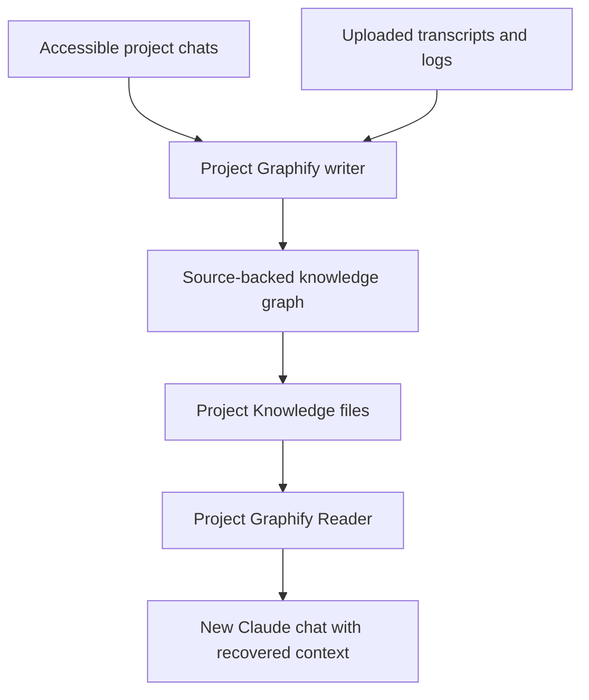

# Project Graphify

**Evidence-backed project memory and knowledge graphs for Claude Projects.**

## Release v1.0.1

This maintenance update responds to two live tests in a Claude Project.
The Reader retrieved 105 graph nodes, 259 relationships and 103 evidence
records, while the graph audit exposed generated-as-quotation evidence,
inverted relationship directions, and inconsistent chat coverage labels.
Version 1.0.1 adds browser/CLI schema compatibility (`edges` and `links`),
normalization of unambiguously reversed edges, stronger evidence and result
warnings, stable ID preservation across imports, and clearer Writer/Reader
instructions. No Claude browser test of **this new release** is yet claimed.

**Existing user graph files remain separate:** do not replace the only copy of
your current `graph.json`. Back it up first and test any migration on a copy.

Project Graphify helps researchers and developers resume long-running projects
across Claude conversations. It turns accessible chat history, project goals,
experiments, results, code paths, decisions, and blockers into a persistent
graph with source evidence. A companion Reader skill restores that context in
new conversations.

> **Two separate projects:** This repository contains the complete **Project
> Graphify** plugin, including its Writer and Reader skills. The independent
> **Project Graphify Reader** repository provides just the lightweight Reader
> skill for people who do not want the full plugin.

**Project Graphify** is the knowledge-graph writer. **Project Graphify Reader**
is the independent recovery skill for new chats in the same Claude Project.
The bundle also contains the unmodified source of the original **Graphify**
code graph engine under `resources/graphify-source/` plus a dependency-free
conversation/project-state graph builder in `tools/project_graphify.py`.

## Why this project exists

Claude chats can get long, and a new chat may omit important goals, previous
results, failed experiments or exact local paths. This plugin organizes
evidence-backed project history into a durable, queryable graph with two
levels: (1) a compact recovery digest; (2) a source-linked graph of goals,
decisions, code paths, experiments, results, tasks and blockers. It is designed
for projects with many papers, code files, checkpoints and scientific results.
Its source-aware approach helps prevent *proposed commands* from being confused
with *completed executions*, and *validation scores* from being reported as
*final test scores*.

## Features

| Capability | What Project Graphify preserves |
| --- | --- |
| Project goals | Motivation, intended outcome, success criteria |
| Progress | Completed milestones, pending tasks, unresolved blockers |
| Scientific results | Dataset, run, seed, evaluation split, metric, exact value |
| Code and files | Historical paths, purposes, relationships, evidence |
| Decisions | Methods, constraints, rationale, and changes over time |
| Source provenance | Chats, messages, excerpts, logs, and confidence categories |
| Conflicting records | Both claims and an explicit warning; no silent replacement |
| Graph query | Node search, relationship paths, incremental merging |
| Original Graphify | Bundled upstream code graph engine for supported local deployments |

Facts use five evidence categories: `observed`, `user_reported`,
`assistant_proposed`, `inferred`, and `unknown`.

## Architecture



## Installation: Claude web chat

1. Upload `project-graphify-plugin.zip` through Claude's **custom plugin**
   installation interface (where this capability is available). The ZIP has
   one root `project-graphify-plugin/` and a valid manifest beneath
   `.claude-plugin/plugin.json`. Nothing needs to run on the user's computer.
2. Open the *intended* Claude Project and paste `PROJECT_INSTRUCTIONS.md` into
   the Project's Instructions. Keep the current project isolated.
3. In an existing project chat, ask: **"Use Project Graphify to read the
   accessible chats in this project. Build the knowledge graph with full
   provenance and prepare continuation files."** The skill will use the
   actually available Claude search, memory, and file capabilities.
4. Save `graph.json`, `GRAPH_REPORT.md`, `PROJECT_MEMORY.md`, `CONTINUATION.md`,
   and `evidence.jsonl` in **Project Knowledge** if Claude allows direct
   project file writes; otherwise download them and upload into the Project.
5. In a new chat ask **"Use Project Graphify Reader. Continue from the latest
   verified state."** The Project Instructions encourage automatically
   applying the Reader at the start of new chats.

For a separately uploadable standalone Claude skill, use
`project-graphify-reader.zip` with root `project-graphify-reader/SKILL.md`.
If the full plugin is installed, do not install the standalone Reader again.

## Generated files

| Output | Purpose |
| --- | --- |
| `graph.json` | Queryable project entities, edges, and evidence |
| `GRAPH_REPORT.md` | Human-readable goals, results, paths, blockers and work |
| `PROJECT_MEMORY.md` | Compact project continuity digest |
| `CONTINUATION.md` | Safe next-step and outstanding-state handoff |
| `evidence.jsonl` | Node-linked evidence records |
| `code-graph.original.json` | Unmodified Graphify code graph, when imported |

## Repository structure

```text
project-graphify-plugin/
├── .claude-plugin/plugin.json
├── skills/
│   ├── project-graphify/SKILL.md
│   └── project-graphify-reader/SKILL.md
├── tools/project_graphify.py
├── resources/graphify-source/
├── examples/sample_history.json
├── tests/test_project_graphify.py
├── evals/skill_scenarios.md
├── PROJECT_INSTRUCTIONS.md
└── README.md
```

## Reality of browser access (important)

- Claude's native *project-scoped chat search* may retrieve earlier messages,
  but does not guarantee an exhaustive enumeration of every prior chat.
  For complete coverage supply/export **all** transcripts and verify inventory.
- Claude native memory is a helpful compact index, not a user-addressable
  general-purpose graph database. This plugin cannot force hidden memory
  writes or store arbitrary complete graph JSON in that hidden memory.
- A ZIP containing Python source does not grant Claude web chat access to
  the user's Ubuntu filesystem. Local paths recorded from pasted logs are
  historical and are not verified present now.
- The browser supports skills, but cannot execute a bundled local MCP server
  or locally analyze a repository without an authorized environment/tool.
  Original Graphify's AST analysis is available **when run separately** on
  actual code; all its bundled features remain in its original source.
- There is no automatic background process firing on every chat. Project
  Instructions encourage context restoration when a new chat begins, within
  Claude's available tool and memory privileges.

## Optional local CLI: repeatable graph artifact

Use this only when a suitable terminal or execution tool is available. The
history graph builder uses the Python standard library and does not require
an online model or extra Python dependencies:

```bash
python3 tools/project_graphify.py build --input examples/sample_history.json --output graphify-project-out
python3 tools/project_graphify.py query --graph graphify-project-out/graph.json --term baseline
python3 tools/project_graphify.py path --graph graphify-project-out/graph.json --from 'research-goal' --to 'baseline-task'
python3 tools/project_graphify.py audit --graph graphify-project-out/graph.json
```

`--existing old/graph.json` incrementally merges older facts; conflicting
values are retained. Historical Claude-generated `project-graphify/v1` files
with `edges`, and older CLI `project-graphify-1.0` files with `links`, are
both supported. New CLI output includes matching `edges` and `links` keys for
backward compatibility. Known reversed `generated` and `failed_due_to`
relationships are normalized with an explicit warning. A citation matching
its own generated summary is flagged, not treated as independent evidence.
`--code-graph graphify-out/graph.json` imports the native
Graphify code graph while retaining its original unmodified JSON alongside the
result. `--include-message-text` explicitly opts into storing raw chat text;
otherwise message metadata/digests are stored to reduce privacy exposure.

The CLI records raw conversations as source/message nodes and can detect
historical Linux paths. It does **not** understand arbitrary unstructured
transcripts semantically without structured facts produced by a reading step.

Detailed evidence schema: `skills/project-graphify/references/schema.md`.
Query help: `python3 tools/project_graphify.py --help`.

## Installing / running original Graphify code engine

See [the original Graphify documentation](resources/graphify-source/README.md)
and original `pyproject.toml` for
dependencies and supported interfaces. This Python code is **not** executed by
uploading the Claude web plugin. The supplied source and licenses are retained
to preserve AST extraction, code graph, callflow, import/dependency relations,
native export and MCP functionality in supported local deployments.

Original upstream project: [Graphify-Labs/graphify](https://github.com/Graphify-Labs/graphify).

## Testing and verification

```bash
python3 -m unittest discover -s tests -v
```

The updated source passes **18 offline unit tests**, including provenance,
proposed-versus-completed status, conflict preservation, stable IDs,
incremental legacy-browser merging, relationship normalization, graph queries,
and native Graphify code-graph import.
Manual skill scenarios are documented in
[evals/skill_scenarios.md](evals/skill_scenarios.md). Browser-side plugin
installation remains subject to the actual Claude account and platform.

## Privacy and safety

Inspect chat exports for API keys, credentials, personal information and
private research data before writing durable graph files or uploading them.
**Do not publish private project conversations or experiment logs in a public
GitHub repository.** The files here are the plugin implementation and a
synthetic example, not the user's live project history.
No dependency installation, network requests, background sync, training or
filesystem edits are performed by the plugin itself. The CLI only reads
explicitly supplied inputs and writes to an explicitly selected output path.

## Attribution

Bundled original Graphify code is attributed to its upstream authors; see
`resources/graphify-source/LICENSE`, `LICENSE-MIT`, and `NOTICE`. New Project
Graphify conversation graph tools and skills are a separate adaptation. The
plugin manifest declares Apache-2.0. Preserve all upstream notices when
redistributing and review bundled license terms before assigning a
repository-wide license. This is an independent adaptation, **not** an
official Anthropic or Graphify-Labs release.
